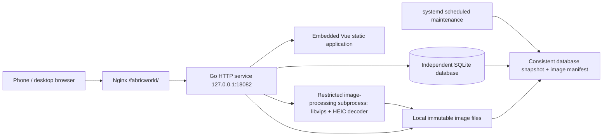

# FabricWorld Technical Plan

Status: reviewed design baseline; core implementation and first installation are complete. Date: 2026-09-19. The sections below describe the tradeoffs made during planning. For current implementation and verification, defer to [ARCHITECTURE.md](ARCHITECTURE.md), [OPERATIONS.md](OPERATIONS.md), and [VERIFICATION.md](VERIFICATION.md).

This plan is the design baseline reviewed by the user. The GitHub repository was subsequently confirmed as public. Performance figures in this document remain targets; the acceptance documentation determines whether they were achieved.

See [WORKS.md](WORKS.md) for the later finished-work record module: a completed-work collection, pattern and making notes, and source-fabric links. Remnants are still updated manually from fabric details.

## 1. Recommended Plan and Review Items

Build FabricWorld as a photo-first fabric collection tool: opening it immediately shows existing fabrics; a photo can be saved at once, with material, dimensions, storage location, and purchase information completed later as needed. After using fabric, the user can update the remnant. While shopping, the user can quickly determine whether similar material is already at home.

Recommended stack: **Vue 3 + TypeScript + Go + SQLite + local image files**. Reuse ali's Nginx, systemd, and subpath deployment model, adding libvips plus a HEIC-decoding dependency. Embed the frontend build in the Go program; do not run a frontend build or Node application on the server.

| Decision | Recommendation in this plan | User impact |
| --- | --- | --- |
| Usage scope (confirmed) | One shared fabric library; the same URL and same data on every device | Centralized device authentication, with no personal data partitioning; authorized devices can view, upload, modify, and delete |
| Initial-release priorities | Photo intake, materials and dimensions, search and filters, storage location, remnants, recycle bin, and export | Covers acquisition, finding, use, and recovery of accidentally deleted records |
| Network entry point | Initially reuse HTTP at `/fabricworld/` and take photos through the system file picker | Verify photo compatibility on real devices; do not promise a complete PWA or in-page camera preview for the HTTP version |
| Photo storage | Store metadata-cleaned standard photos with a maximum long edge of 2560 px plus thumbnails | Controls space and loading time; exports contain processed photos rather than original camera files |
| Deployment | Independent service, database, data directory, and release identity; store images locally | Avoids object-storage costs and an additional database service for now |
| GitHub | `Crashmere/FabricWorld`, visibility public (confirmed) | Create after review approval when implementation begins; source visibility can be adjusted separately |

At this planning stage, the user explicitly requested no login or identity authentication and confirmed “a shared fabric library that anyone holding the URL can view and edit.” This plan therefore introduced no password, access token, or account and did not partition personal data. That item was confirmed and did not require another review.

## 2. Verified Environment and Constraints

Verified on 2026-09-19 through local checks, the trusted SSH alias `ali`, and GitHub read-only interfaces:

- At the start of planning, the current directory was empty. Implementation later established the public `Crashmere/FabricWorld` repository.
- The server's `/opt/AGENTS.md` was read explicitly. The SHA-256 hashes of four shared remote operations references matched their local maintenance sources.
- ali had 2 vCPUs and approximately 1.7 GiB of memory; about 1.25 GiB was available at inspection time, with no swap. Its 40 GiB root disk had approximately 33 GiB free. This resource headroom is not a capacity guarantee.
- Nginx was configured only for HTTP port 80 and dispatched applications by path. Ledger used `127.0.0.1:18080`; FeeTable used `127.0.0.1:18081`. Both services and Nginx were active, and both proxied health endpoints succeeded.
- Nothing was listening on `18082`, and `/opt/fabricworld` did not exist. These were only candidate values and had to be rechecked before deployment.
- The configured Ubuntu repositories offered candidate packages for `libvips-tools` and `libheif-plugin-libde265`, neither then installed; `libheif1` was installed. Package availability did not mean HEIC decoding had been verified.

Shared server conventions are maintained by `agent-config/skills/server-operations`. This project owns only its own application configuration. Production addresses, keys, real photos, databases, and backups do not enter Git.

## 3. Initial Product Scope

### 3.1 Fabric Records

One record represents one kind of fabric acquired together and intended to be managed as one batch. A repeat purchase of the same fabric may copy basic information into a new record. Copying does not copy photo references, purchase date, or remnants, avoiding accidental mixing of separate batches.

| Information | Design |
| --- | --- |
| Photos | Up to 10 per record; support phone camera, photo library, desktop file selection, and drag-and-drop; allow cover selection, reordering, removal, and full-image viewing |
| Name | May be entered manually, for example “blue small-flower cotton”; when empty, generate the exact fallback `布料 + 录入日期`, which may be renamed later |
| Material | Multi-select common fibers and allow custom values, such as the exact Chinese choices `棉`, `麻`, `羊毛`, and `涤纶`; a single selection defaults to 100%; after adding a second, both percentages are empty; with multiple selections, enter the percentage before each item; keep composition notes as independent text |
| Dimensions and quantity | Each fabric-piece group records width, length, and the count of pieces with identical dimensions; support multiple groups with different dimensions |
| Status | Unused, in use, or used up; defaults to unused |
| Storage location | Custom text with suggestions from existing values, for example “upper wardrobe / box 2” |
| Optional information | Color, pattern/use tags, purchase date, shop, total purchase price, and notes |

Quick intake does not require dimensions or material. At least one photo or a manually entered name is enough to create a record. Unmeasured dimensions are explicitly shown as “to be completed” and are never replaced with 0. A record without a photo can also be saved and uses a lightweight placeholder card.

Material names support search and identification. Percentages are stored as an independent map of decimal strings; multiple selections may be empty, their total is not required to equal 100, and user input is not rounded. Composition notes remain independent. Total purchase price is the original acquisition cost and does not decrease with the remnant.

### 3.2 Dimension and Remnant Rules

- The UI defaults to centimeters and can switch to meters. The server stores integer millimeters. Centimeters permit at most one decimal place; meters permit at most three. Example: width 150 cm and length 2.5 m are stored as 1500 mm × 2500 mm.
- Each group has a positive integer piece count. Width and length may independently be unknown; when known, they must be greater than 0. The initial plan limits each record to 50 groups, each group to 999 pieces, and each dimension to 1000 m, with validation in both backend and frontend.
- A new record defaults to one unmeasured piece. A record with stock has at least one group. “Unused” and “in use” have pieces; “used up” has none. Validate status and piece changes in the same transaction.
- The details page provides the exact action `更新余料`: directly enter the dimensions currently remaining, split into multiple pieces, or adjust the count. Example: after using part of a 150 × 250 cm piece, change it to 150 × 180 cm; after splitting it into two pieces, save two dimension groups.
- Submitting through `更新余料` changes the status to “in use” by default. Completing an unmeasured dimension or correcting an entry mistake in ordinary editing does not change status automatically. The exact action `标记用完` requires confirmation, removes current pieces, and preserves the before-change snapshot. Adding pieces again changes the status to “in use.”
- An irregular remnant can record maximum width and length plus a shape note. Those dimensions aid identification but do not represent a guaranteed cuttable rectangle. A matching-dimensions filter includes only complete rectangles by default; unknown or irregular dimensions do not promise usability.
- Every save stores a change summary and before/after business snapshots, making original purchase dimensions and remnant changes visible. It does not record the modifier because there is no application identity system. The initial release shows history but does not provide complex history merging or arbitrary version rollback.
- Do not combine fabrics of different widths into a misleading “total meters” figure. Home-page statistics need only record count, in-stock count, and incomplete-information count.

### 3.3 Finding, Organizing, and Exporting

- Search name, material, tags, shop, storage location, and notes, including Chinese substring matching.
- Filter by material, color, status, storage location, and tag, with minimum length/width filters. One remaining rectangular piece must satisfy all dimensions simultaneously; do not join multiple pieces. Do not rotate warp and weft directions automatically by default.
- Sort by most recent purchase by default, using entry date when purchase date is absent; also allow most recently modified and name sorting. Add stable ID as the tie-breaker.
- Load 24 records on the first page, with an explicit `加载更多` action after scrolling. Preserve filters and list position when returning from details. Store filters and sorting in the URL so refresh and desktop opening retain them.
- Deletion moves a record to a 30-day recycle bin from which it can be restored; maintenance removes expired records. The ordinary UI does not provide immediate permanent deletion that bypasses the recycle bin. Used up and deleted are distinct states.
- Export records as CSV or as a ZIP containing a JSON manifest and standard photos. Escape CSV formula prefixes. Stream ZIP output and limit concurrency rather than loading every photo into memory. Export in-stock records—unused and in use—by default and allow explicit inclusion of used-up records. Ordinary export excludes recycle-bin records.
- ZIP is a data-portability format. The initial release does not provide web import/recovery; complete disaster recovery uses operational backups.

The initial release excludes AI material identification, automatic dimension measurement from photos, shopping-site collection, cutting-layout algorithms, works-in-progress management, social sharing, user accounts, offline synchronization, and multi-library permissions. Photos cannot measure true dimensions reliably; the user always confirms dimensions.

## 4. Phone and Desktop Interaction

### 4.1 Primary Pages

| Page | Phone | Desktop |
| --- | --- | --- |
| Fabric library | Two-column photo cards, search at the top, filters in a bottom sheet, and a fixed `新增` action at lower right; fall back to one column at extremely narrow widths according to content | Responsive 3–5-column cards, with filters expandable at the side |
| Create / edit | Dedicated page with photos above, materials and dimensions in the middle, optional information collapsed, and a fixed save area at the bottom | Maximum-width form with photos and fields in columns |
| Fabric details | Large image, status, remaining dimensions, and storage location in sequence; editing and remnant updating are easy to reach | Gallery on the left, information on the right, with history in a separate area |
| Recycle bin | Card list, deletion date, and restore entry | Same functions using the wider layout |
| Material management | Searchable material list, add on no result, fabric count, and bulk-removal confirmation | Centered list with the same operations |

The top-right hamburger opens a menu containing recycle-bin and material-management entries. Remove the original fabric-library button; clicking the brand at left returns home. Material usage counts include the recycle bin and identify it separately. After removal confirmation, delete the material and its percentages from every related fabric while preserving fabrics, photos, and composition notes; restore 100% when one material remains.

The visual direction uses a warm-white background, muted supporting colors, and clear text hierarchy, keeping fabric photos primary. The interface is Chinese-first, and its main title may use the exact text `我的布料`; do not add decoration or marketing copy unrelated to the management task.

### 4.2 Quick Photo Flow

1. Select the exact action `新增`, then choose `拍照` or `从相册选择`. Keep the two entries separate; desktop shows file selection and drag-and-drop.
2. Show a local preview and per-image progress immediately while uploading in sequence in the background. If HEIC cannot be previewed locally, show a processing placeholder. The user can fill in information concurrently.
3. Show material, dimensions, and storage location, while allowing immediate save without completing them. If any selected photo has not uploaded successfully, require retry or explicit removal before save; do not silently omit it.
4. After a successful save, open details and offer `继续录入`. On failure, preserve input and photos already uploaded successfully.

The camera entry uses `<input type="file" accept="image/*" capture="environment">` to request the rear camera. The photo-library entry omits `capture` and allows multiple selection. `capture` is a browser hint and does not guarantee that every browser opens the camera directly; retain the system-picker fallback experience.

### 4.3 Usability and Weak Networks

- Common touch targets are at least 44 × 44 CSS px, and input fonts are at least 16 px; numeric fields use appropriate `inputmode` values. Accommodate safe areas, orientation, and the soft keyboard. The Save button must not cover the last field.
- Cards reserve a fixed image ratio and show only the necessary number of text lines. Collapse excessive tags to avoid layout shifts. Status is conveyed by text as well as color.
- Returning to the list restores position. Filters update results only after submission. Empty results, no-photo records, first use, and upload failures each provide an actionable next step.
- Save the current form's text draft for the session. After refresh, restore text and still-valid staged-photo references. Refresh loses local files that have not uploaded and must explicitly ask the user to select them again. A draft is not formal data or an offline write queue.
- When offline, clearly show that the record is unsaved. Clear a draft only after server success is confirmed. Writes use idempotent requests; after a timeout, check the result before deciding whether to retry so mobile-network retransmission cannot duplicate records.
- Provide keyboard operation, focus feedback, associated form labels, and inline errors. Do not make swipe, long press, or drag the only way to perform an action. Photo ordering also provides move-forward/move-back buttons.

## 5. Technical Architecture



| Layer | Choice and rationale |
| --- | --- |
| Frontend | Vue 3, TypeScript, Vite, and Vue Router; close to existing projects and easy to maintain; responsive CSS without a heavyweight admin template |
| Backend | Go standard HTTP service with direct organization of business validation and SQL; one application, without a separate queue or microservices |
| Database | SQLite with candidate driver `modernc.org/sqlite`; WAL, foreign keys, short write transactions, and busy waits suit a single instance with a few devices |
| Images | libvips command line plus HEIC decoder plugin; Go invokes a fixed executable with structured arguments, avoiding shell concatenation and large images remaining resident in memory |
| Runtime | Go program with embedded frontend plus official-package image dependencies; managed by systemd, proxied by Nginx, with logs in the journal |

Here, “single application” includes image-processing subprocesses started on demand; this is not a completely dependency-free single-binary deployment. The image tools provide reliable HEIC, orientation, color, and thumbnail handling. Browser-only conversion would shift compatibility and memory pressure to the phone.

During implementation, choose supported stable versions from official sources and lock dependencies. Prefer Ubuntu's officially signed repository for image-processing dependencies. No software was installed during this planning round.

### 5.1 Code Organization

```text
FabricWorld/
  cmd/fabricworld/       entry points for serve, init, migrate, backup, check, restore, and others
  internal/httpapi/      request parsing, origin checks, and error mapping
  internal/fabric/       fabrics, dimensions, filters, versions, and SQL
  internal/media/        uploads, decoding, thumbnails, and file lifecycle
  internal/backup/       consistent database-and-image backup/recovery
  migrations/            explicit schema migrations
  web/                   Vue pages, components, request layer, and browser tests
  deploy/                project Nginx, systemd, backup, and release templates
  docs/                  architecture, API, operations, local release, and acceptance notes
```

Do not begin by designing a generic plugin system, a complex repository abstraction, or a cross-project shared business package. Maintenance scripts use Go, shell, or existing build tools and do not add a Python runtime dependency.

## 6. Data Model and Consistency

| Object | Key fields / responsibility |
| --- | --- |
| `fabrics` | ID, name, material list, material percentages and composition note, color, tags, status, storage location, purchase information, notes, `revision`, and created/modified/deleted times |
| `fabric_pieces` | `fabric_id`, width/length in millimeters, piece count, irregular flag, shape note, and order; represents currently remaining fabric |
| `media` | ID, owning fabric or staged state, main/thumbnail relative paths, dimensions, byte count, digest, order, and removal time |
| `fabric_changes` | `fabric_id`, `revision`, action, time, and before/after business snapshots; does not store original image bytes |
| `operations` | Idempotency key, request fingerprint, operation state and result, and expiration time |

The initial release stores materials and tags as bounded JSON string arrays and queries them through SQLite JSON. Common items are derived from existing records. Location is text; editing one record does not implicitly rewrite others. The target scale is approximately 10,000 fabric records, with image volume separately controlled by disk quota. Measure query plans and indexes before introducing a full-text search service.

Material management merges all current records, including the recycle bin, with the independent `material_catalog(name,id)` table. When search has no result, allow adding a zero-use material; it is available in the editor and is not automatically deleted while unused. Bulk removal matches an exact name and validates the catalog's random identity plus a digest of related records' ID/`revision` set. In one transaction, remove the catalog entry, update all records, write change history, and store the idempotent result. A stale catalog returns 409 and requires reconfirmation. For an unknown result, preserve the original request key for lookup/retry and refresh recovery. Unused built-in suggestions that were not independently added do not appear in the catalog. Saved custom materials can be reused in the editor. `migrate` explicitly creates the compatible catalog table while preserving the v1 format for program rollback.

Database indexes cover non-deleted status, update time, purchase date, and relation-table foreign keys. The server applies complex filters before pagination, and list counts cover the complete filtered set rather than only the current page.

- Store monetary amounts as integer Chinese yuan cents. The API accepts decimal strings for amounts and dimensions with units; do not use binary floating point for inventory or money. Empty amount and 0 are distinct.
- Store purchase dates as `YYYY-MM-DD` and operation times as UTC instants; the UI displays operation times in the device's local time zone.
- Modification, remnant updates, photo binding/order, deletion, and restoration all check `revision`. When another device has changed the record, return 409, preserve the current form, and ask the user to refresh and compare.
- Create and other writes carry an idempotency key, with the result committed in the business transaction. The same key/request returns the original result; the same key with a different request is rejected. After a client network timeout, query the operation result first. Retain idempotency results for a proposed seven days; do not blindly retry an unknown write after expiration.
- Update the record and image references in one transaction; each save succeeds or fails as a unit. Image decoding does not occupy a database write transaction.
- Normal service startup requires the database to exist with the correct identity and compatible schema. First installation explicitly runs `init` for an empty database. A missing database, corruption, or migration failure must not be hidden by automatically creating an empty database.

## 7. Photo Upload, Processing, and Lifecycle

### 7.1 Input and Output

The initial release accepts static JPEG, PNG, WebP, HEIC, and HEIF images. The server identifies formats from content and does not trust extensions or client MIME types. Reject SVG, executable content, and unsupported animated/multiframe input. For a phone Live Photo, accept only its static photo, not the video. Correctly selecting the primary image from ordinary iPhone HEIC is mandatory during technical validation.

Suggested initial limits: 25 MiB per file, at most 80 megapixels, and at most 10 photos per record. Nginx allows upload requests slightly larger than the file limit to accommodate multipart overhead; the application enforces the exact limit. Ordinary JSON requests have a separate smaller limit. When a limit is exceeded, explain the available remediation in Chinese.

Image-processing order: validate format and dimensions → normalize EXIF/HEIF orientation → convert to sRGB using input color information → resize → output the JPEG main image and WebP thumbnail → remove EXIF/GPS and other metadata. Convert color before removing metadata. Do not promise that photo color equals the physical object.

- The main image has a maximum long edge of 2560 px and a default JPEG quality near 88; the thumbnail has a maximum long edge of 640 px and WebP quality near 80. Do not enlarge small images. Place PNG transparency on a fixed light background. Tune parameters with fabric-texture and pattern samples. Fine textures may be photographed separately in close-up; do not use a compressed overview in place of a macro image.
- Do not retain original uploads long term. Remove temporary input after processing. On image-processing failure, explain the cause and preserve a retryable state.
- Do not depend on a cloud image API or upload photos to a third-party recognition service.
- The browser manages previews, progress, and per-image retries. In the initial release, do not require phone-side full-image decoding or compression before save; standardization happens on the server.

### 7.2 Separating Upload from Submission

1. Upload each photo separately, with client concurrency defaulting to one. The server first streams to a temporary directory and verifies actual byte count, avoiding an entire batch in memory.
2. Initially set global image-processing concurrency to one, with a processing timeout, bounded wait queue, and subprocess-exit cleanup. Return retryable busy feedback rather than allowing an unbounded backlog.
3. Completely write and synchronize processing output at its final path before creating a bindable `media_id`. The server generates filenames; user filenames are never used as paths.
4. A successfully staged image does not mean the fabric has been saved. When the user saves the form, the backend atomically creates or updates the fabric and binds valid staged photos. A bound photo cannot be bound again to another record.
5. Staged photos remain valid for 24 hours. Maintenance cleans unreferenced files. A bounded reconciliation task reclaims orphaned files left when a crash occurs after file write but before database commit.
6. Saved images remain immutable; replacement creates a new file. Removed images are retained for 30 days before cleanup. When an entire fabric is deleted, retain its photos so recycle-bin restoration works. History guarantees business snapshots only and does not promise permanent retention of cleaned historical photos.

Lists request only thumbnails; load main images on demand when opening details. Reserve width/height space, lazy-load, and use bounded HTTP caching. Recycle-bin and removed images are not exposed through the ordinary media endpoint. Cache duration remains short; the application cannot revoke an image another party already downloaded.

### 7.3 Resource Controls

- Apply upload rate limits, concurrency limits, decoded-pixel limits, subprocess timeouts, and systemd resource constraints. Origin rate limits prevent mistakes and abuse; they do not identify a person.
- Image subprocesses and the application share FabricWorld's resource allocation. Begin load testing with a proposed 640 MiB memory limit and approximately one CPU; do not limit only the Go heap while excluding the decoder. Exceeding a limit may fail a task or restart the service, requiring idempotency and temporary-file reclamation for recovery. Determine final values from 48 MP HEIC/JPEG and concurrent-browsing measurements.
- Recommend an initial effective media quota of 5 GiB. Monitor actual disk usage including temporary files, recycle-bin data, and retained backups. Reject new uploads when the root disk has less than 5 GiB free, while preserving browsing and management of existing data. Do not count only database-bound images.
- For 1,000 records with four processed photos each, a rough estimate of 0.5–1.5 MiB per image produces approximately 2–6 GiB. Texture and content significantly affect size. The 5 GiB initial quota is adjustable and is not a guaranteed record count.

## 8. API and Access Boundaries

The external prefix is consistently `/fabricworld/`. Nginx strips it, and Go uses internal `/api/...` and `/media/...` paths. Vite assets, Vue Router, and the API client share one base configuration.

| Example endpoint | Purpose |
| --- | --- |
| `GET /api/fabrics` | Search, filtering, sorting, and pagination |
| `POST /api/fabrics` | Create a record and bind photos |
| `GET /api/fabrics/{id}` | Details, pieces, photos, and `revision` |
| `PUT /api/fabrics/{id}` | Save the complete form and remnants, checking the version |
| `DELETE /api/fabrics/{id}` | Move to the recycle bin, checking the version |
| `POST /api/fabrics/{id}/restore` | Restore from the recycle bin, checking the version |
| `GET /api/fabrics/{id}/changes` | Change history |
| `POST /api/uploads` | Upload and process one image, returning a staged reference |
| `GET /api/operations/{key}` | Check the result of a timed-out write |
| `GET /api/suggestions` | Suggestions for used materials, tags, and storage locations |
| `GET /api/materials` | Saved materials, fabric counts, recycle-bin counts, and set versions |
| `POST /api/materials` | Persist a zero-use name; requires an idempotency key |
| `POST /api/materials/remove` | Atomically remove all uses by name and set version; requires an idempotency key |
| `GET /api/export` | CSV or photo ZIP from a consistent snapshot under the current filters |
| `GET /media/{id}/{variant}` | Validated media response that does not expose disk paths |
| `GET /healthz` | Service health without records, photos, or internal configuration |

Errors consistently include a stable error code, readable message, and field errors. Key statuses include 409 version conflict, 413 file too large, 415 unsupported format, 422 invalid input, and 429 busy/rate limited.

This is a network service without identity authentication. Anyone able to reach it can perform the listed business operations and export data. An undisclosed address, random record IDs, a path prefix, or a private GitHub repository cannot be treated as access control.

The design still applied baseline validation compatible with that model: write-origin checks, no cross-origin CORS, body-size limits, parameterized SQL, plain-text rendering of user input, only safely re-encoded images, fixed media `Content-Type` with `nosniff`, and a CSP for the new project. HTTP Origin checks only reduce accidental operations launched by cross-site pages and cannot stop a direct client. Different application paths on one IP are not browser security boundaries.

The current five applications use HTTPS with a trusted IP certificate. See [shared HTTPS operations](https://github.com/Crashmere/agent-config/blob/main/skills/server-operations/references/https.md) for the shared Nginx entry point, automatic renewal, and rollback. HTTPS provides transport encryption. The application remains primarily online and still has no `getUserMedia`, Service Worker, or offline capability.

## 9. Deployment, Release, and Existing-Project Impact

| Item | Recommended value |
| --- | --- |
| Repository | `Crashmere/FabricWorld`, to be created during implementation |
| External path | `/fabricworld/`; `/fabricworld` redirects while preserving query parameters |
| Internal listener | `127.0.0.1:18082`; no new public application port |
| Directories | `/opt/fabricworld/{bin,config,data,backups,docs,releases}` |
| Data | `data/fabricworld.db`, `data/media/`, and `data/tmp/` |
| Identities | Runtime `fabricworld`; release `fabricworld-deploy` |
| Services | `fabricworld.service` and backup service/timer; maintenance cleanup has a separate explicit entry point |
| Nginx | This project maintains a location configuration linked from `/etc/nginx/app-locations/fabricworld.conf` |

The application user can write only its own data and approved directories. Root manages the program and configuration. Restrict permissions on data and backup directories. The application serves images itself rather than exposing the entire data directory through Nginx.

First deployment installs official image dependencies, creates directories and runtime identities, explicitly initializes an empty database, starts the application, and integrates it with Nginx. Later releases update only the program and required configuration without overwriting runtime data. Schema changes use explicit migration, a consistent pre-release backup, and version checks. Program rollback must not masquerade as database rollback.

After launch acceptance, update the project maintenance entry point and architecture/API/operations/release documentation. Add FabricWorld to the shared application inventory, recording its port, identities, dependencies, backups, and health path, then synchronize server documentation and its source marker. Shared-skill maintenance uses `personal-skill-management`; this planning round did not write a candidate plan into server current state.

Impact on existing applications is limited to shared host resources and loading a new Nginx location. Before and after deployment, verify Ledger and FeeTable health endpoints, page deep links, static assets, and their API paths. Reload Nginx gracefully after `nginx -t` succeeds; do not restart the server or migrate an old project for the new application. Before installing image dependencies, inspect the package manager's planned changes. If it proposes effects such as additional service restarts, adjust the implementation approach first.

## 10. Backup and Recovery

Photos and the database must form one recoverable dataset. Never copy only the main file of an active WAL database. A database-only backup also cannot recover images.

The recommendation was daily backup at 03:30 China Standard Time with 0–5 minutes of random delay, avoiding existing 03:00 and 03:15 jobs. Retain 14 daily backups, plus bounded pre-release backups. Record schedules and space limits as explicit parameters in deployment documentation.

Consistency procedure:

1. Backup and media cleanup share a cross-process maintenance lock. During backup, block file reclamation while allowing normal database reads and writes to continue.
2. Use SQLite's consistent backup interface to create an independent database snapshot. Enumerate required images from that snapshot, including references still within their recycle period.
3. Because image files are immutable and references commit only after file persistence, files listed in the snapshot can be backed up stably. Record each file's path, size, and digest. If an image is missing, fail the backup and report it in logs; do not mark the backup complete.
4. For same-disk snapshots, hard-link immutable media and independently copy the database snapshot to avoid duplicating every photo across 14 days. If the filesystem does not support hard links, estimate capacity before using copies. The production application must never overwrite a media file in place.
5. After manifest, database-integrity, and image-digest checks pass, atomically mark the backup complete, then apply retention. A failed backup must not replace the previous successful backup.

ZIP export similarly obtains a consistent record/media manifest, uses the maintenance lock to prevent cleanup of those files, and enforces export concurrency and duration limits. A long download must not hold a database write transaction.

Hard links reduce duplicate allocation but do not protect against whole-disk loss or underlying file corruption. The initial release continued using local backups and offered complete download export. Off-machine backup was recommended for a later user-selected destination and was not claimed to exist at that time.

Before first launch, restore one genuinely generated backup in an isolated directory and use synthetic records and photos to verify the database, covers, standard main images, recycle bin, and remnant states. Before production recovery, confirm the restore point, stop writes, preserve the current recoverable state, and then switch the complete data directory. Verify a migrated database together with the corresponding program version.

## 11. Implementation Sequence and Acceptance

### Stage A: Validate High-Risk Areas First

In an isolated development/test environment, create the minimal camera-upload flow. Use JPEG, PNG, WebP, iPhone HEIC, portrait/landscape orientation, wide-gamut, and 48 MP samples to check:

- System camera/photo-library selection, cancel, and return on iPhone Safari and Android Chrome through the HTTPS entry point. Do not substitute a desktop simulator for real-device results.
- Ubuntu image dependencies can decode the primary HEIC image, preserve correct orientation, remove GPS, and produce standard images viewable by mainstream browsers.
- Peak image-processing memory, duration, concurrency limits, and failure cleanup are acceptable while existing services remain healthy.

If common devices cannot complete the camera flow, or HEIC/resource validation fails, first adjust the camera/decoder approach and update this plan before listing the capability as deliverable. “Supports file upload” is not a substitute for the acceptance requirement “the phone can take a photo.”

### Stage B: Complete the Core Loop

Initialize the repository and project. Implement schema, idempotency and version conflicts, the photo lifecycle, fabric list/create/details/edit, material dimensions and remnants, search and filters, recycle bin, and export. Complete both phone and desktop layouts. All business verification uses synthetic data.

### Stage C: Complete Operations and Delivery

Implement consistent backup and isolated recovery, restricted local-machine release, deployment templates, diagnostics, and rollback documentation. Complete target-environment deployment, existing-application regression checks, and synchronization of the shared inventory and server documentation. Every stage begins only after the plan is approved.

### Launch Acceptance Checklist

| Scope | Pass condition |
| --- | --- |
| Phone layout | No horizontal overflow at at least 375×667, 390×844, and the narrower 320 px width; soft keyboard, safe area, and Save button are usable |
| Desktop layout | At 1440×900, cards, filters, form, and gallery use space appropriately; data entry can be completed from the keyboard |
| Real phones | iOS Safari and Android Chrome each pass camera, photo-library multiselect, cancel, photo rotation, and real upload |
| Inventory rules | cm/m conversion is correct; multiple piece groups, irregular remnants, unknown dimensions, and used-up state are consistent; filters use remaining dimensions |
| Weak network and concurrency | Offline/timeout behavior does not duplicate creation; partial upload failure is recoverable; two-device conflicts are visible and never overwrite silently |
| Images and boundaries | Corrupt files, disguised types, excessive pixels, HEIC, metadata, processing timeout, and low disk have explicit behavior; no partial record remains |
| Deletion and recovery | Fabrics and photos enter their retention periods; restoration is complete; expiration cleanup does not delete a file still referenced by a record or backup |
| Backup and export | Backup coexists with concurrent upload/deletion; isolated recovery restores consistent database and photos; CSV/ZIP contents cover the expected filtered set |
| Subpath | Detail-page refresh works; assets, API, media, and redirects all work correctly under `/fabricworld/` |
| Existing projects | Ledger and FeeTable health and primary read-only paths work; internal ports still listen only on loopback |

Performance targets use a fixed dataset, recorded cold/warm caches, and a recorded test network. With approximately 10,000 synthetic records, ordinary list/filter API p95 should be below 300 ms. Simulated Fast 4G initial-view LCP should be below 2.5 s. A single image should usually process within 8 s on the test set, excluding upload time, with recoverable timeout. These are acceptance targets that require measurement after image parameters and resource limits are fixed; they cannot be treated as results in advance.

## 12. Reviewed Conclusions

The recommendation was to proceed with “shared fabric library + phone-first + local image storage + Vue/Go/SQLite + system camera picker,” validating real-phone photography and HEIC first before expanding the complete feature set.

The user approved the initial scope, shared HTTPS entry point, processed-photo retention policy, and technical route, and changed repository visibility to public. A public GitHub repository is a confirmed decision. Source visibility does not change the online access model without identity authentication.

## References

- [MDN: HTML capture attribute](https://developer.mozilla.org/en-US/docs/Web/HTML/Reference/Attributes/capture)
- [MDN: getUserMedia and secure contexts](https://developer.mozilla.org/en-US/docs/Web/API/MediaDevices/getUserMedia)
- [MDN: capabilities restricted to secure contexts](https://developer.mozilla.org/en-US/docs/Web/Security/Defenses/Secure_Contexts/features_restricted_to_secure_contexts)
- [Official libvips documentation](https://www.libvips.org/)
- [Official libheif documentation](https://libheif.org/)
- [Shared server maintenance source](https://github.com/Crashmere/agent-config/tree/main/skills/server-operations)

Public references were used to confirm capabilities and limitations. Server usage, package candidates, and application health came from read-only checks during that planning round. Final compatibility is determined by implementation acceptance.
